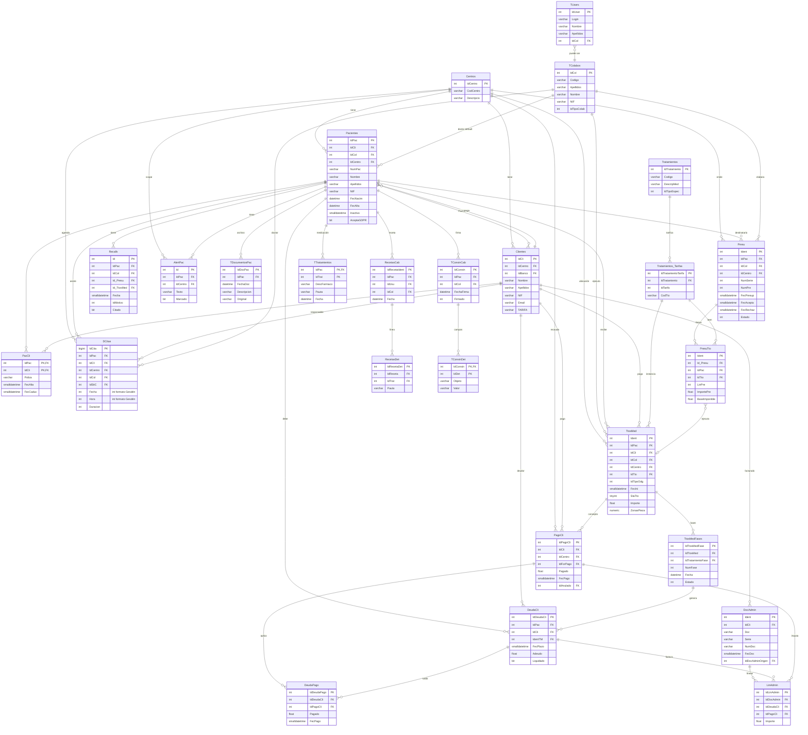

# Diagrama ER simplificado — núcleo Gesdén

Diagrama Mermaid limitado al core para la migración a Dentalpin. Excluye catálogos hoja, auditoría y tablas vacías. Para FKs completas, ver `sql/exploration/02_foreign_keys.sql`.

> Render en GitHub, VSCode con extensión Mermaid, o Metabase Markdown card.

## Vista paciente / clínico / financiero

## Lectura rápida

- **Centro y Profesional** son los dos ejes verticales que tocan a casi todo.
- **Paciente ↔ Cliente** es M:N vía `PacCli`. Crítico para facturación.
- **TtosMed** (tratamiento aplicado) es el "evento clínico" central. Hereda de un presupuesto (`PresuTto.IdTtoMedOrig` ↔ `TtosMed.IdPresuTto`) y descompone en sesiones (`TtosMedFases`).
- **Cadena financiera**: `TtosMedFases` → `DeudaCli` → `DeudaPago` ← `PagoCli` → `LinAdmin` → `DocAdmin`. Una factura agrupa deudas y pagos aplicados.
- **Comunicaciones y clínica secundaria** (`AlertPac`, `Recalls`, `RecetasCab/Det`, `TConsinCab/Det`, `TDocumentosPac`, `TTratamientos`) cuelgan directamente del paciente.
